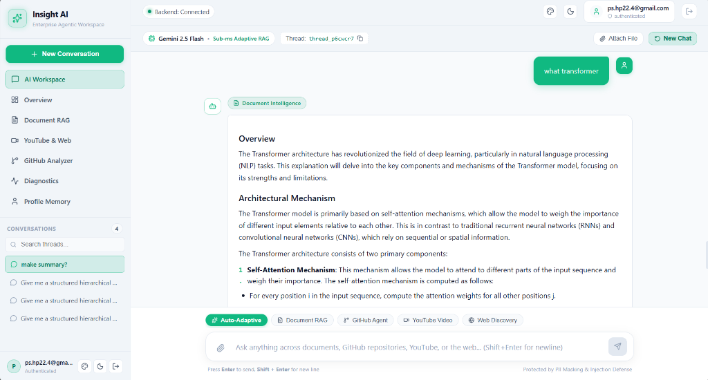
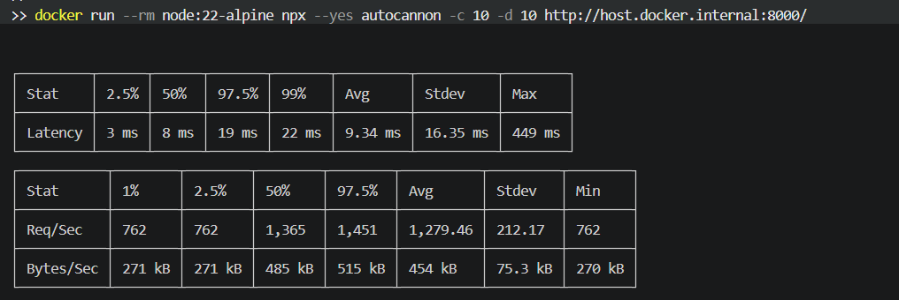
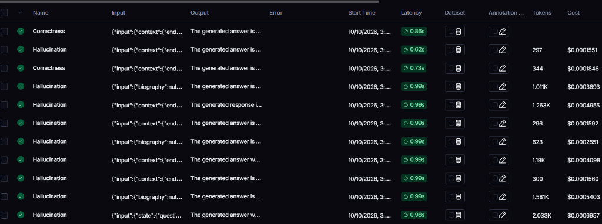
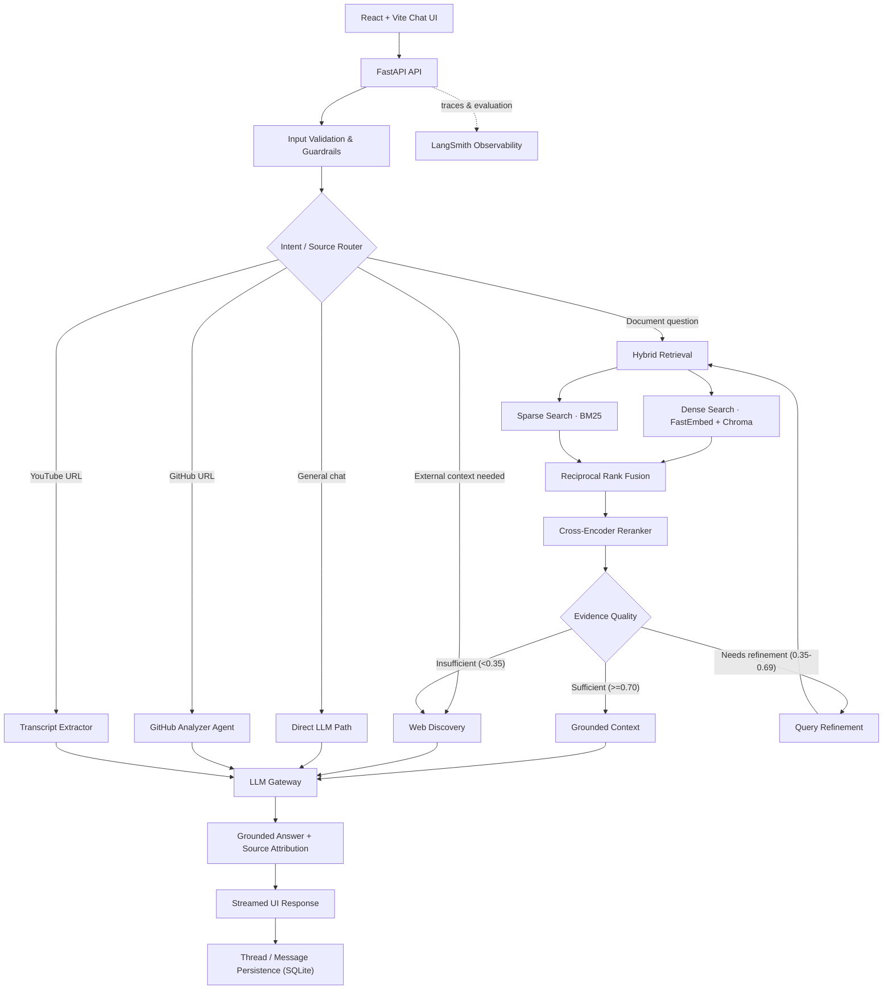
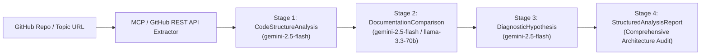

<div align="center">

# ✨ Insight AI

### Enterprise Multimodal RAG & Agentic Knowledge Assistant

**Turn scattered documents, repositories, videos, and web sources into grounded, traceable answers.**

<p>
  
  
  
  
  
</p>

<p>
  <a href="#-the-goal">Goal</a> ·
  <a href="#-product-preview">Screenshots</a> ·
  <a href="#-features">Features</a> ·
  <a href="#-architecture">Architecture</a> ·
  <a href="#-technology-stack">Tech Stack</a> ·
  <a href="#-model-matrix">Models</a> ·
  <a href="#-evaluation--observability">Evaluation</a> ·
  <a href="#-quick-start">Quick Start</a>
</p>

</div>

---

## 🎯 The goal

Enterprise knowledge is spread across PDFs, office documents, source-code repositories, video transcripts, and the web. Traditional keyword search can miss semantic matches, while general-purpose chat can produce fluent answers without verifiable evidence.

**Insight AI is an agentic knowledge assistant designed to connect these sources in one observable workflow.** It routes a request to the appropriate capability, retrieves relevant evidence, generates a grounded response, and exposes traces that help developers inspect system behavior.

> **Ask one question. Search the right sources. Get an answer you can investigate.**

### Who it is for

- **Engineering teams** auditing repositories, architecture, dependencies, and documentation drift.
- **Knowledge workers** asking questions across documents and reference material.
- **Researchers and learners** extracting explanations from documents, videos, and web sources.
- **AI engineering teams** developing retrieval workflows that need traceability and evaluation.

---

## 🖥️ Product preview

### Insight AI workspace

The interface brings conversations, document-aware chat, and source-specific agents into one workspace.

<p align="center">
  
</p>

### Load-test snapshot

This screenshot shows one HTTP load-test run against the backend service. Its numbers reflect this specific test setup and environment.

<p align="center">
  
</p>

### Evaluation and observability

LangSmith traces provide visibility into evaluator runs, latency, token usage, and estimated cost across the workflow.

<p align="center">
  
</p>

---

## 🚀 Features

### 📄 Multimodal document intelligence
- Ingest supported PDF, DOCX, and TXT documents.
- Extract text and structured content; page rendering and vision-based analysis support diagrams, charts, and tables.
- Retrieve relevant passages and generate answers strictly grounded in document context.
- Support page-level attribution and grounded citation badges.

### 🧠 Hybrid retrieval and corrective RAG (CRAG)
- **Dense retrieval:** Semantic vectors with FastEmbed ONNX (`BAAI/bge-small-en-v1.5`) and ChromaDB.
- **Sparse retrieval:** Session-aware BM25 for exact terms, names, and identifiers.
- **Reciprocal Rank Fusion (RRF):** Combine ranked candidates from both retrieval channels.
- **Cross-encoder reranking:** Reorder candidates using query–passage relevance (`cross-encoder/ms-marco-MiniLM-L-6-v2`).
- **Corrective RAG (CRAG):** Dynamically select direct answering, query refinement, or live web fallback according to evidence-quality signals.

### 🐙 GitHub codebase analysis
A specialized cognitive agent that audits repository structure, module responsibilities, dependencies, API entry points, data models, documentation-code drift, and potential architectural risks.

### 🎬 YouTube intelligence
Extract available transcripts, summarize video content, and answer transcript-grounded questions.

### 🌐 Web discovery
Cleaned search queries via DuckDuckGo with lexical noise filtering (removing irrelevant stop-word dictionary definitions for technical questions) when configured retrieval evidence is insufficient.

### 💬 Thread-aware chat and semantic caching
Organize conversations by thread with server-side context isolation. High-speed Redis semantic caching prevents cross-thread cache leakage.

### 🛡️ Guardrails and resilience
- PII masking and prompt-injection defense layers.
- Evidence-aware anti-hallucination response generation.
- Dynamic LLM gateway with graceful failover across Gemini, Ollama, and OpenRouter.

---

## 🏗️ Architecture



### Request lifecycle

1. **Receive** user message or source-specific request from the frontend.
2. **Validate** input and apply security/PII sanitization controls.
3. **Route** to direct chat, document RAG, GitHub analysis, YouTube transcript analysis, or web discovery.
4. **Retrieve** using dense and sparse search, fuse rankings with RRF, and rerank candidate passages with Cross-Encoder.
5. **Correct** weak retrieval by refining query or triggering adaptive web fallback.
6. **Generate** answer using grounded evidence and strict anti-hallucination prompts.
7. **Stream and persist** response and conversation state to SQLite thread storage.
8. **Observe** execution with real-time LangSmith trace nodes.

---

## 🧩 Technology stack

| Layer | Technology | Responsibility |
| :--- | :--- | :--- |
| **Frontend** | React, Vite, Lucide Icons | Responsive chat workspace, source modes, and interactive widgets |
| **API** | FastAPI, Uvicorn | Request routing, streaming SSE endpoints, and validation |
| **Agent Workflows** | LangChain, LangGraph | Stateful workflow composition, CRAG loops, and reflection |
| **Vector Store** | ChromaDB | Persistent local vector indexing |
| **Embeddings** | FastEmbed ONNX | 384-dimensional dense semantic vectors (zero PyTorch overhead) |
| **Lexical Retrieval** | BM25 (Rank-BM25) | Exact keyword and identifier matching |
| **Neural Reranker** | `cross-encoder/ms-marco-MiniLM-L-6-v2` | Query–passage relevance probability scoring |
| **Primary LLM** | Google Gemini 2.5 Flash | Fast reasoning, multimodal vision, and evidence synthesis |
| **Fallback Models** | Ollama (`llama3.2:latest`) / OpenRouter | Local offline or cloud fallback inference |
| **Cache / Rate Limits** | Redis | Thread-isolated semantic response caching and sliding-window rate limiting |
| **Persistence** | SQLite (`dev.db`) | Thread history, episodic memory, and analytics |
| **Observability** | LangSmith | Traces, latency breakdowns, and recall evaluation runs |
| **Deployment** | Docker Compose | Multi-container deployment with volume persistence |

---

## 🤖 Model matrix

### 1. General System Models

| Component | Model / Engine | Purpose |
| :--- | :--- | :--- |
| **Primary LLM** | `gemini-2.5-flash` | RAG synthesis, intent routing, and multimodal analysis |
| **Advanced LLM** | `gemini-1.5-pro` | Deep complex reasoning (when configured) |
| **Local Fallback** | `llama3.2:latest` via Ollama | Zero-cost local fallback inference |
| **Cloud Fallback** | `meta-llama/llama-3.3-70b-instruct` via OpenRouter | Alternative hosted cloud inference |
| **Dense Embeddings** | `BAAI/bge-small-en-v1.5` | High-efficiency 384-dim semantic embeddings |
| **Sparse Retrieval** | BM25 | Lexical token matching |
| **Neural Reranker** | `cross-encoder/ms-marco-MiniLM-L-6-v2` | Candidate passage reranking |
| **Document Parsing** | PyMuPDF / pdfplumber | PDF extraction and visual figure rendering |
| **Visual Vision** | Gemini 2.5 Flash Vision | Diagram and chart interpretation |

---

### 2. Models Used Exclusively for GitHub Codebase Analysis

The **GitHub Analyzer Agent** ([`app/agents/github_analyzer_agent.py`](file:///d:/rag_h/app/agents/github_analyzer_agent.py)) uses a dedicated multi-stage cognitive pipeline:



- **`gemini-2.5-flash`** *(Primary)*:
  - **Structural Analysis**: Parses file trees, module dependencies, API entry points, and database models into structured Pydantic representations (`CodeStructureAnalysis`).
  - **Drift Detection**: Compares `README.md` and docstrings against actual source code to identify stale documentation (`DocumentationComparison`).
  - **Diagnostic Hypothesis Generation**: Formulates architectural hypotheses, race conditions, and error patterns (`DiagnosticHypothesis`).
  - **Final Audit Report**: Synthesizes findings, security risks, scalability bottlenecks, and actionable recommendations into a structured report (`StructuredAnalysisReport`).
- **`meta-llama/llama-3.3-70b-instruct`** / **`llama3.2:latest`** *(Fallback)*:
  - Automatically handles GitHub audit tasks if Gemini quota is exhausted or if local execution is enforced.

---

## 📊 Evaluation & observability

### Mathematical Definition of Recall@k
For query $q$, ground-truth relevant chunks $R_q$, and top-$k$ retrieved chunks $D_{q,k}$:

$$\operatorname{Recall@k}(q) = 100 \times \frac{|R_q \cap D_{q,k}|}{|R_q|}$$

For $N$ dataset questions:

$$\operatorname{MeanRecall@k} = \frac{1}{N} \sum_{q=1}^{N} \operatorname{Recall@k}(q)$$

### 1. Live Traceable Node (Real-Time)
Retrieval recall is calculated automatically during live queries inside [`calculate_recall_node`](file:///d:/rag_h/app/rag_workflow.py#L1180-L1250) (`@safe_traceable(run_type="evaluator")`) and logged directly to the LangSmith trace tree without running batch experiments.

### 2. Standalone Recall Evaluation Module
Run the standalone evaluation pipeline against the 20-question Transformer dataset:

```powershell
# 1. Run formula verification unit tests (8/8 tests pass)
.\venv\Scripts\python.exe evaluate_recall.py --mode test-formula

# 2. Inspect PDF chunks inventory
.\venv\Scripts\python.exe evaluate_recall.py --mode inspect

# 3. Review ground-truth labels table
.\venv\Scripts\python.exe evaluate_recall.py --mode review-labels

# 4. Run full evaluation across top-3, top-5, and top-10
.\venv\Scripts\python.exe evaluate_recall.py --mode evaluate --k-values 3 5 10
```

### Load-test benchmark snapshot

The provided benchmark snapshot reports these values for one `autocannon` run against `http://host.docker.internal:8000/`:

| Metric | Reported Value |
| :--- | :--- |
| **Average Latency** | 9.34 ms |
| **Median Latency** | 8 ms |
| **97.5th Percentile** | 19 ms |
| **99th Percentile** | 22 ms |
| **Maximum Latency** | 449 ms |
| **Average Requests/Sec** | 1,279.46 req/sec |

---

## ⚙️ Requirements

- Python 3.11+ compatible with `app/requirements.txt`.
- Node.js 18+ and npm for the React Vite frontend.
- Docker Desktop and Docker Compose for container deployment.
- Google Gemini API key (or local Ollama instance).
- Optional LangSmith and OpenRouter credentials.

---

## 🚀 Quick start

### 1. Clone the repository

```bash
git clone <YOUR_REPOSITORY_URL>
cd rag_h
```

### 2. Configure environment variables

```powershell
Copy-Item .env.example .env
```

Fill in your configuration:

```ini
# Persistence
DATABASE_URL=sqlite:///./app/data/dev.db

# LLM Gateway
PRIMARY_PROVIDER=gemini
DEFAULT_LLM_PROVIDER=gemini
GEMINI_API_KEY=your_gemini_api_key_here
GEMINI_MODEL=gemini/gemini-2.5-flash

# Optional local Ollama
OLLAMA_BASE_URL=http://localhost:11434
OLLAMA_MODEL=ollama/llama3.2:latest

# Embeddings & Vector Store
EMBEDDING_MODEL_NAME=BAAI/bge-small-en-v1.5
CHROMA_PERSIST_DIRECTORY=./app/data/chroma_db

# Optional Redis
REDIS_URL=redis://localhost:6379/0
RATE_LIMIT_ENABLED=true

# Optional LangSmith Tracing
LANGSMITH_TRACING=true
LANGSMITH_ENDPOINT=https://api.smith.langchain.com
LANGSMITH_API_KEY=your_langsmith_api_key_here
LANGSMITH_PROJECT=rag-app
```

> **Dynamic API Key Support**: You can also pass the Gemini API key dynamically via request headers (`x-gemini-api-key: your_key`) without setting it in `.env`.

### 3. Start services with Docker Compose

```bash
docker compose up --build -d
docker compose ps
```

### 4. Run locally without Docker

**Backend (FastAPI):**
```powershell
python -m venv venv
.\venv\Scripts\Activate.ps1
pip install -r app/requirements.txt
uvicorn app.main:app --host 0.0.0.0 --port 8000 --reload
```

**Frontend (React + Vite):**
```powershell
cd ui
npm install
npm run dev
```

Visit the interactive UI at **`http://localhost:5173`**.

---

## 🔌 API overview

| Method | Endpoint | Purpose |
| :--- | :--- | :--- |
| `POST` | `/api/v1/chat` | Standard RAG chat response with semantic caching |
| `POST` | `/api/v1/chat/stream` | Token-streaming completion |
| `POST` | `/api/v1/chat/sse` | SSE response with workflow telemetry |
| `POST` | `/api/v1/upload/file` | Upload and ingest supported files (PDF, DOCX, TXT) |
| `POST` | `/api/v1/upload/url` | Ingest content from a public URL |
| `POST` | `/api/v1/github/analyze` | Run GitHub repository analysis |
| `GET` | `/api/v1/health` | Service health status |
| `GET` | `/api/v1/threads` | List conversation threads |

---

## 🔐 Security and production checklist

- [x] Enforce authentication and thread-scoped context isolation.
- [x] Store secrets in environment variables or secret managers; never commit API keys.
- [x] PII masking and prompt injection defense layers on untrusted input.
- [x] Non-critical Redis caching with graceful fail-open resilience.
- [x] Traceable observability and evaluation with LangSmith.

---

## 📄 License

MIT License. Designed and engineered for scalable, verifiable enterprise agentic workflows.

<div align="center">

**Insight AI — from fragmented information to grounded, observable knowledge workflows.**

<sub>Built with FastAPI · LangGraph · ChromaDB · FastEmbed · React · LangSmith</sub>

</div>
